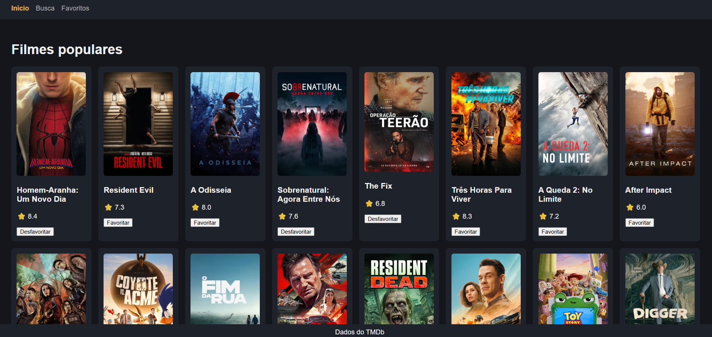
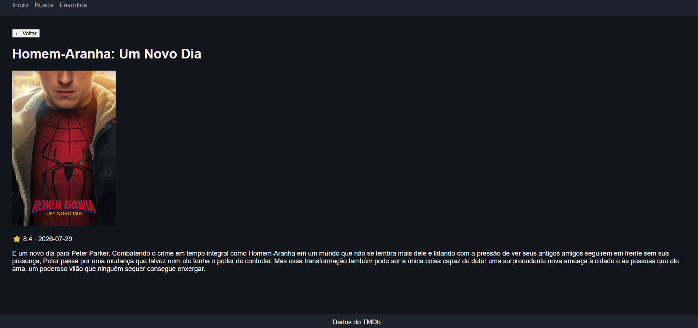
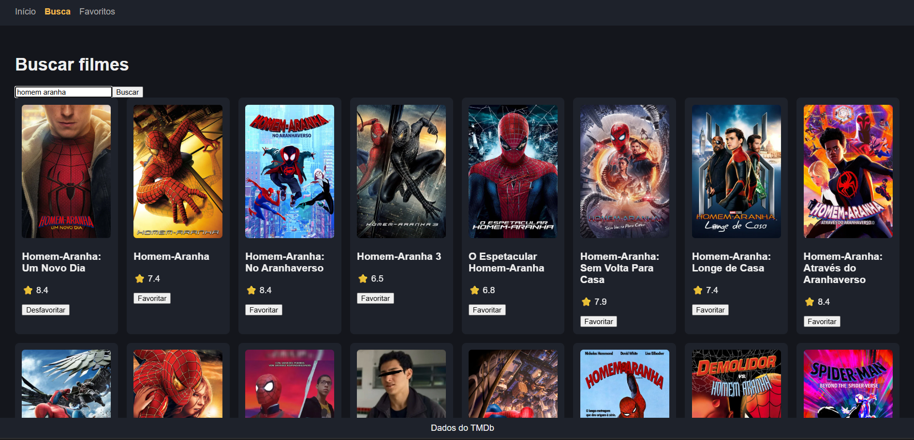
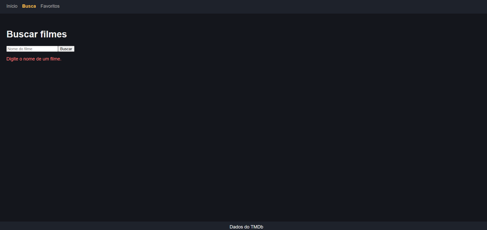
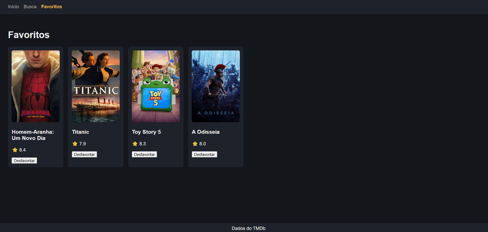
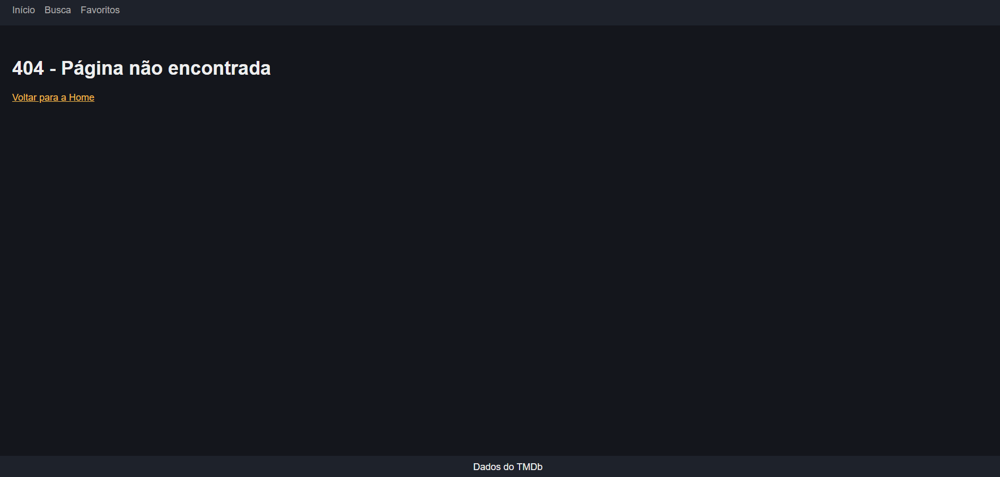

# Catálogo de Filmes

Aplicação web (SPA) para explorar, buscar e favoritar filmes, consumindo a API do [TMDb](https://www.themoviedb.org/).
Projeto final da disciplina de React.



---

## Funcionalidades

- **Navegação SPA** com cabeçalho compartilhado, links ativos e página 404
- **Filmes populares** com tela de carregamento e tratamento de erro
- **Detalhes do filme** em rota dinâmica (`/filme/:id`) com botão de voltar
- **Busca** com formulário controlado e validação de campo vazio
- **Favoritos** salvos no navegador, mantidos mesmo após recarregar a página

---

## Telas

### Página inicial


### Detalhes do filme


### Busca


### Busca com erro de validação


### Favoritos


### Página 404


---

## Tecnologias

| Tecnologia | Uso |
| --- | --- |
| React | Componentes, `useState` e `useEffect` |
| React Router | Rotas, `NavLink`, `Outlet`, `useParams` e `useNavigate` |
| Vite | Ambiente de desenvolvimento |
| TMDb API | Dados e posters dos filmes |
| localStorage | Persistência dos favoritos |

---

## Rotas

| Rota | Página |
| --- | --- |
| `/` | Filmes populares |
| `/filme/:id` | Detalhes do filme |
| `/busca` | Busca de filmes |
| `/favoritos` | Lista de favoritos |
| `*` | Página 404 |

---

## Estrutura do projeto

```
src/
├── components/
│   ├── Layout.jsx
│   ├── Navbar.jsx
│   └── MovieCard.jsx
├── pages/
│   ├── Home.jsx
│   ├── Detalhes.jsx
│   ├── Busca.jsx
│   ├── Favoritos.jsx
│   └── NaoEncontrada.jsx
├── App.jsx
├── main.jsx
└── index.css
```

---

## Como rodar o projeto

**1. Clone o repositório e entre na pasta**

```bash
git clone <url-do-repositorio>
cd catalogo-filmes
```

**2. Instale as dependências**

```bash
npm install
```

**3. Configure a chave da API**

Crie um arquivo `.env` na raiz do projeto (ao lado do `package.json`):

```
VITE_API=sua_chave_aqui
```

Para obter a chave, crie uma conta gratuita em [themoviedb.org](https://www.themoviedb.org/) e solicite uma chave em **Configurações > API**.

> O arquivo `.env` está no `.gitignore` e não deve ser enviado ao GitHub.

**4. Inicie o servidor**

```bash
npm run dev
```

Abra o endereço exibido no terminal (normalmente `http://localhost:5173`).

---

## Conceitos praticados

- Componentes reutilizáveis e comunicação por **props**
- Estado com **`useState`** e efeitos colaterais com **`useEffect`**
- Consumo de API com **`fetch`**
- Formulários controlados com validação
- Imutabilidade do estado (spread para adicionar e `filter()` para remover)
- Persistência com **`localStorage`**
- Rotas dinâmicas e navegação programática

---

## Créditos

Este produto usa a API do TMDb, mas não é endossado nem certificado por ele.


